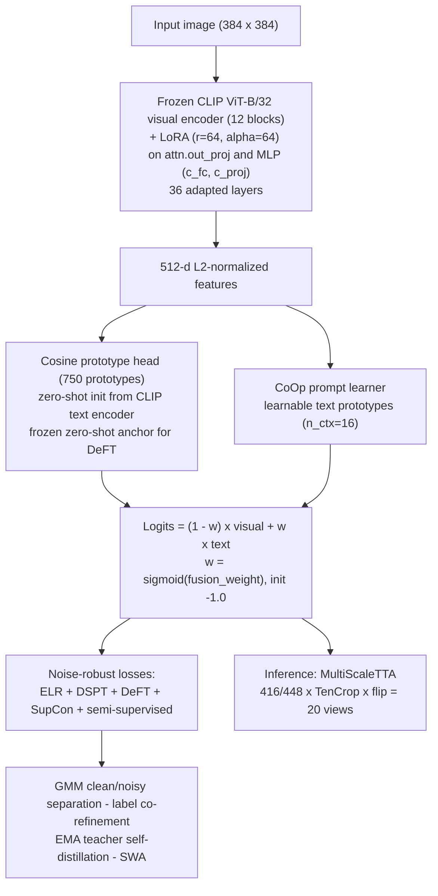

# Robust Fine-Grained Recognition under Noisy Labels

**CLIP ViT-B/32 + LoRA · ELR + DSPT + DeFT robust losses · MultiScaleTTA — a single-model solution for AIC-2026 Track 4**

<div align="center">


-75.09%25-success?style=flat-square)


</div>

---

## Overview

This repository is the single-model solution of **Team Xuanruihan** (submission `AIC-2026-98713574`) for the *Global Campus Artificial Intelligence Algorithm Elite Competition (AIC-2026)*, Track 4 — **robust fine-tuning of CLIP ViT-B/32 for fine-grained recognition with web-supervised (noisy) labels**.

The competition setting combines three difficulties:

- **Label noise** — training data is web-crawled and never human-verified; a large fraction of labels are wrong.
- **Long-tailed distribution** — class frequencies are extremely imbalanced, while the test set is class-balanced and human-verified.
- **Fine-grained visual differences** — sub-categories differ only in small details, and **ensembles are forbidden**: the final score must come from a single model and a single inference pipeline.

The solution follows one guiding idea: **strong prior + conservative adaptation**. A frozen CLIP prior provides a clean reference distribution; noise-robust losses and training strategies constrain how far the model is allowed to adapt to the (noisy) labels.

Data scale: **750 classes**, ~149K noisy web-crawled training images, 37,444 human-verified class-balanced test images.

## Results

| Protocol | Test labels | Inference | Top-1 |
|---|---|---|---|
| Official test set (leaderboard) | human-verified | MultiScaleTTA (20 views) | **71** pts |
| Stratified class-balanced holdout | human-verified | single view | 74.25% |
| Stratified class-balanced holdout | human-verified | MultiScaleTTA (20 views) | **75.09%** |
| Internal noisy validation | noisy (train-split) | single view | 79.49% |

Notes:

- The **stratified class-balanced holdout** (9:1 per-class split, seed 42, at least one held-out sample per class) is the honest offline protocol: same distribution as the official balanced test set, labels held out from training.
- **MultiScaleTTA** (2 scales × TenCrop with flips = 20 views) adds a stable **+0.84 pt** on the balanced holdout without changing the model.
- Full experiment logs, ablations and scale sweeps: [`docs/results.md`](docs/results.md).

## Highlights

- **Parameter-efficient adaptation** — frozen CLIP ViT-B/32 with LoRA (r=64, α=64) injected into 36 linear layers: `attn.out_proj` plus the MLP projections (`c_fc`, `c_proj`) of every one of the 12 transformer blocks (open_clip's CLIP attention keeps q/k/v fused in a single `in_proj` parameter, so they carry no adapters); ≈8.4M trainable parameters (5.25% of the ≈160M total).
- **Zero-shot classifier prior** — cosine-prototype head built directly in CLIP's 512-d feature space (no projection), initialized from CLIP text-encoder prototypes of the class names, and kept as a frozen anchor for soft-label distillation.
- **Composite noise-robust losses** — ELR (early-learning regularization) + DSPT (dual-softmax, gradient suppression for anomaly samples) + DeFT-inspired clean soft labels from the frozen zero-shot anchor + SupCon on clean samples + semi-supervised pseudo-label regularization on the noisy subset.
- **DivideMix-style dynamic sample selection** — per-sample loss history fitted with a 2-component GMM to separate clean / noisy samples online, driving contrastive learning and pseudo-labeling.
- **Label co-refinement + EMA teacher + SWA** — progressive relabeling (α 0.3 → 0.7), mean-teacher self-distillation (α=0.999), and Stochastic Weight Averaging over the last 25% of training; the submitted checkpoint is the SWA weight.
- **FixRes at 384×384** — the ViT positional embedding is bicubically interpolated 7×7 → 12×12 (49 → 144 tokens, CLS kept), unlocking high-resolution fine-grained details at almost zero cost.
- **MultiScaleTTA inference** — at test time the image is resized to 416 and 448 (native ± 32/64), TenCrop with horizontal flips yields 20 views, logits are averaged; chunked fp16 forward keeps memory bounded.
- **Engineering discipline** — per-sample ELR index bookkeeping, hard-label MixUp/CutMix compatible with ELR, class-balanced sampler, honest (label-noise-robust) validation, single-variable experiment scripts under `scripts/`.

## Method



Key components (full details and equations in [`docs/technical-report.md`](docs/technical-report.md)):

1. **LoRA fine-tuning** — `W' = W + (α/r)·B·A` on a frozen backbone; low memory, no catastrophic forgetting.
2. **FixRes 384** — bicubic interpolation of the CLIP positional embedding adapts the frozen ViT to 384×384 input.
3. **Cosine head + zero-shot init** — prototypes live in the CLIP feature space, so text-encoder prototypes can be injected losslessly; a frozen copy (`zero_shot_anchor`) serves as the clean reference for DeFT soft labels.
4. **ELR** — per-sample EMA targets `t_ema` suppress memorization of wrong labels: `L = CE(f(x), y) + λ·log(1 − ⟨t_ema, softmax(f(x))⟩)` with `λ=5.0, β=0.9`.
5. **DSPT (dual softmax)** — `p = softmax(z), q = softmax(p), L = −log q[y]`; bounded gradients adaptively suppress the extreme gradients of noisy samples that conflict with the CLIP prior.
6. **DeFT soft labels** — clean zero-shot probabilities `p_zs` supervise the model (`L = −Σ p_zs·log softmax(z)`, weight 0.3) to decouple learning from noisy hard labels.
7. **GMM selection + refinement + EMA + SWA** — online clean/noisy separation (warmup 10 epochs), progressive label correction, mean-teacher distillation (distill weight 0.3), weight averaging over the last 25% epochs.
8. **MultiScaleTTA** — see above; the most reliable inference-side gain within the single-model constraint.

## Repository structure

```
.
├── main.py                  # single entry point: train / evaluate / noise detection
├── config/                  # dataclass configuration (all hyperparameters)
├── data/                    # indexed dataset, transforms, MixUp/CutMix collator, sampler
├── losses/                  # ELR, GCE, DSPT, EMA teacher, GMM selection, co-refinement, SupCon
├── models/                  # CLIP + LoRA model, LoRA layers, classifier head, prompt learner
├── trainers/                # training loop, evaluator, LR schedulers
├── utils/                   # logging, metrics, checkpointing, noise detection, seeding
├── scripts/                 # training / evaluation / prediction / experiment scripts
├── docs/                    # technical report, results & ablations, design notes (English)
├── results/                 # released predictions for the official test set
└── requirements.txt
```

## Quick start

### 1. Environment

```bash
pip install -r requirements.txt
python -c "import torch, open_clip; print(torch.__version__, torch.cuda.is_available())"
```

The CLIP backbone is downloaded by `open-clip-torch` (`openai` weights). If HuggingFace is
not reachable, place `ViT-B-32_openai.bin` under `data/` — the code picks it up automatically.

### 2. Data layout

```
data/
├── train/                  # noisy training data: one folder per class
│   ├── 0000/ *.jpg
│   ├── 0001/ *.jpg
│   └── ...                 # 750 classes
├── test/                   # flat test images (no labels)
│   └── *.jpg
└── ViT-B-32_openai.bin     # optional local CLIP weights
```

> The config keys `webfg400` / `webinat5000` are historical (earlier rounds of the
> competition used the public WebFG-400 / WebiNat-5000 sets). `get_config("webfg400")`
> is configured for the 750-class competition round — see `config/default.py`.

### 3. Pipeline self-test (synthetic data)

```bash
bash scripts/quick_test.sh        # creates synthetic data, trains 5 epochs, evaluates + TTA
```

### 4. Train the final recipe (FixRes 384 + DSPT + DeFT)

```bash
python main.py \
    --dataset webfg400 \
    --data_root ./data \
    --output_dir ./outputs \
    --exp_name fixres384_hd512_dsp_deft \
    --seed 42 \
    --overrides \
        model.image_size=384 \
        data.image_size=384 \
        model.classifier_hidden_dim=512 \
        model.prompt_fusion_weight=-1.0 \
        loss.loss_type='"elr+ds"' \
        loss.deft_weight=0.3 \
        loss.deft_temperature=1.0
```

### 5. Evaluate / predict

```bash
# evaluation with TTA on the validation split
bash scripts/eval.sh ./outputs/fixres384_hd512_dsp_deft/swa_model.pth webfg400

# official test set -> pred_results.csv (20-view MultiScaleTTA, fp16)
PYTHONPATH=. python scripts/predict_test.py \
    --resume outputs/fixres384_hd512_dsp_deft/swa_model.pth \
    --data_root ./data --output pred_results.csv \
    --batch_size 32 --use_tta

# balanced-holdout re-evaluation (single vs TTA, optional logit adjustment)
python scripts/eval_balanced_val.py \
    --resume outputs/fixres384_hd512_dsp_deft/swa_model.pth \
    --data_root ./data --per_class 10 --mode both

# noise detection (ELR targets / confidence / entropy)
python main.py --detect_noise --dataset webfg400 --data_root ./data
```

### 6. Other experiments

```bash
bash scripts/train_reproduce.sh     # default-config baseline
bash scripts/train_fixres384.sh     # single-variable FixRes experiment
bash scripts/train_sv1_fusion.sh    # fusion-weight experiment #1
bash scripts/train_sv2_fusion.sh    # fusion-weight experiment #2
bash scripts/train_p0.sh            # linear-head / no-augmentation control
```

## Key configuration

| Hyperparameter | Value | Notes |
|---|---|---|
| `model.image_size` | 384 | FixRes (bicubic 49→144 positional interpolation) |
| `model.lora_r` / `lora_alpha` | 64 / 64 | 36 adapted layers: `attn.out_proj` + MLP (`c_fc`/`c_proj`) per block |
| `model.classifier_type` | cosine | prototype head in CLIP feature space |
| `model.classifier_hidden_dim` | 512 | = CLIP feature dim → no projection, zero-shot init applies |
| `model.use_prompt_learner` | True | CoOp-style, `n_ctx=16` |
| `model.prompt_fusion_weight` | -1.0 | sigmoid(-1.0) ≈ 0.27 |
| `loss.loss_type` | `elr+ds` | ELR + DSPT |
| `loss.elr_lambda` / `elr_beta` | 5.0 / 0.9 | ELR regularization |
| `loss.deft_weight` / `deft_temperature` | 0.3 / 1.0 | clean soft-label fusion |
| `loss.use_gmm_selection` | True | warmup 10 epochs, posterior threshold 0.5 |
| `loss.use_label_refinement` | True | α 0.3 → 0.7 |
| `loss.use_supcon` | True | weight 0.1, τ=0.07, clean samples only |
| `train.lr` / scheduler | 5e-4 / OneCycle | 40 epochs, warmup 5, min_lr 1e-7 |
| `train.batch_size` × accum | 64 × 2 | effective batch 128, AMP fp16, grad clip 1.0 |
| `eval.use_tta` | True | MultiScaleTTA, 20 views |

## Documentation

| Document | Content |
|---|---|
| [`docs/technical-report.md`](docs/technical-report.md) | Full technical report: method, data pipeline, losses, training strategy, inference, references |
| [`docs/results.md`](docs/results.md) | Final results, TTA ablations, scale sweeps, development history |
| [`docs/design-notes.md`](docs/design-notes.md) | Engineering design decisions and extension guide |

## Competition constraints

The solution respects the track rules:

- Backbone fixed to **CLIP ViT-B/32** (OpenAI weights) — no replacement, no larger models.
- **Single model / single inference pipeline** — no ensembles, model fusion or multi-model voting (TTA counts as one pipeline).
- **No external data**, no test-set participation in training.
- Noise handling must be fully **automatic** and reproducible from the submitted code.

## References

Key works this solution builds on (full list with citations in [`docs/technical-report.md`](docs/technical-report.md)):

- [CLIP: Learning Transferable Visual Models From Natural Language Supervision](https://arxiv.org/abs/2103.00020) (ICML 2021)
- [LoRA: Low-Rank Adaptation of Large Language Models](https://arxiv.org/abs/2106.09685) (ICLR 2022)
- [Early-Learning Regularization Prevents Memorization of Noisy Labels](https://arxiv.org/abs/2007.00151) (NeurIPS 2020)
- [Intrinsic Gradient Suppression for Label-Noise Prompt Tuning in VLMs (DSPT)](https://arxiv.org/abs/2605.00591) (ICML 2026)
- [Vision-Language Models are Strong Noisy Label Detectors (DeFT)](https://arxiv.org/abs/2409.19696) (NeurIPS 2024)
- [DivideMix: Learning with Noisy Labels as Semi-Supervised Learning](https://arxiv.org/abs/2002.07394) (ICLR 2020)
- [Supervised Contrastive Learning](https://arxiv.org/abs/2004.11362) (NeurIPS 2020)
- [Mean Teachers are Better Role Models](https://arxiv.org/abs/1703.01780) (NeurIPS 2017)
- [Averaging Weights Leads to Wider Optima and Better Generalization](https://arxiv.org/abs/1803.05407) (UAI 2018)
- [CoOp: Learning to Prompt for Vision-Language Models](https://arxiv.org/abs/2109.01134) (IJCV 2022)

## License

[MIT](LICENSE)

## Acknowledgements

Competition: Global Campus AI Algorithm Elite Competition (AIC-2026), Algorithm Challenge,
Track 4 — 网络监督细粒度图像识别. Team Xuanruihan — captain Feng Xuan.
Built on `open-clip-torch`, `PyTorch` and the open-source works listed above.
